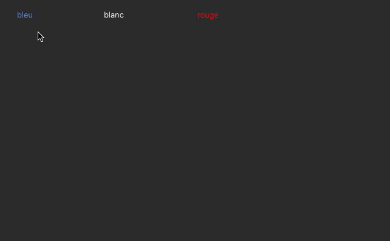

# CopyPasteStyleFormMacro

[![language][code-shield]][code-url]
[![language-top][code-top]][code-url]
![code-size][code-size]
[![license][license-shield]][license-url]
[![discord][discord-shield]][discord-url]

Copy some style keys from one selected object and paste them to another, or save/load named styles.

## Macro classes

List of macros defined here: [Project/Sources/FormMacros.json](Project/Sources/FormMacros.json)

#### Abstract classes

* [FormMacro](Project/Sources/Classes/FormMacro.4dm) shares some functions between macro classes.
* [StyleMacro](Project/Sources/Classes/StyleMacro.4dm) shares the style-related helpers.

### CopyStyle

[CopyStyle](Project/Sources/Classes/CopyStyle.4dm) copies the selected object style into the pasteboard using JSON format.

Not all style keys are copied; the list of keys is [here](Project/Sources/Classes/StyleMacro.4dm#L4) in code. More could be added (see TODO, e.g. background color).

### PasteStyle

[PasteStyle](Project/Sources/Classes/PasteStyle.4dm) reads the style from the pasteboard and applies it to the selected element.

### SaveStyle

[SaveStyle](Project/Sources/Classes/SaveStyle.4dm): select an object and give the style a name. It is saved in a shared file (`Folder(fk user preferences folder).file("styleMacro.json")`) for reuse with the next macro.

### LoadStyle

[LoadStyle](Project/Sources/Classes/LoadStyle.4dm): select an object and launch the macro. A menu is shown to pick one of the saved styles to apply.

## TODO

- Apply the style to a list of selected elements
- More style keys
- Instead of setting `null`, unset when pasting style if not defined

## Other components

<!-- MARKDOWN LINKS & IMAGES -->
<!-- https://www.markdownguide.org/basic-syntax/#reference-style-links -->
[code-shield]: https://img.shields.io/static/v1?label=language&message=4d&color=blue
[code-top]: https://img.shields.io/github/languages/top/mesopelagique/CopyPasteStyleFormMacro.svg
[code-size]: https://img.shields.io/github/languages/code-size/mesopelagique/CopyPasteStyleFormMacro.svg
[code-url]: https://developer.4d.com/
[license-shield]: https://img.shields.io/github/license/mesopelagique/CopyPasteStyleFormMacro
[license-url]: LICENSE.md
[discord-shield]: https://img.shields.io/badge/chat-discord-7289DA?logo=discord&style=flat
[discord-url]: https://discord.gg/dVTqZHr
